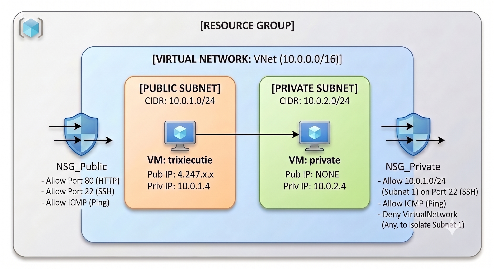
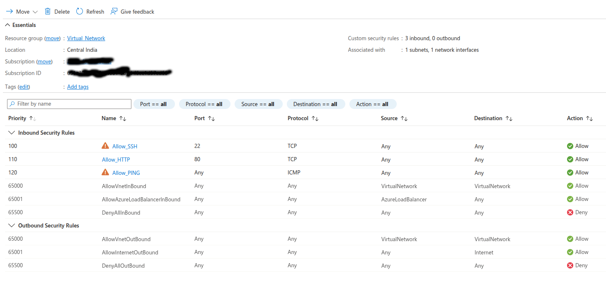
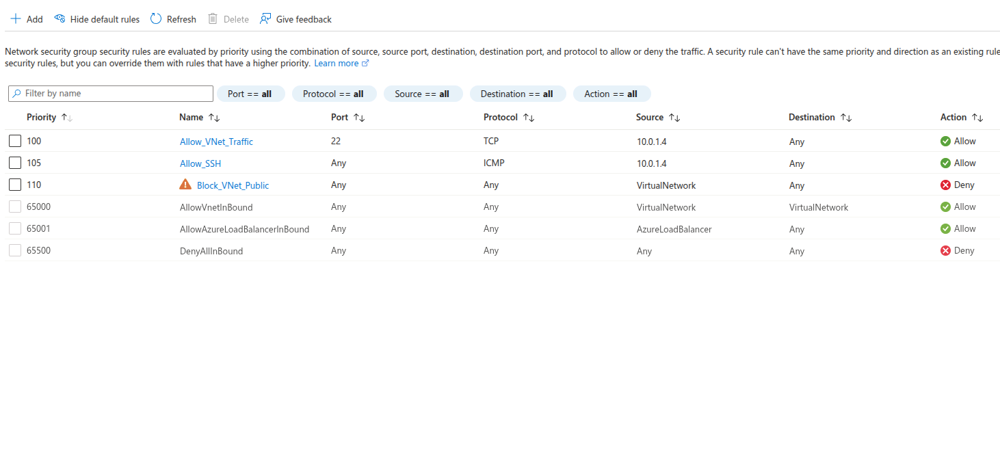
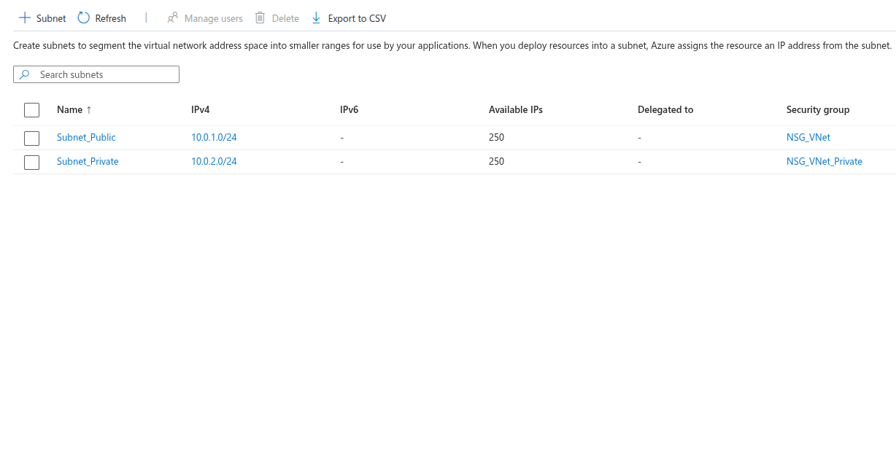
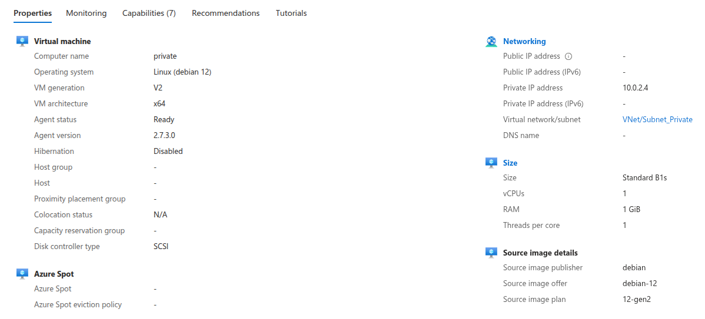
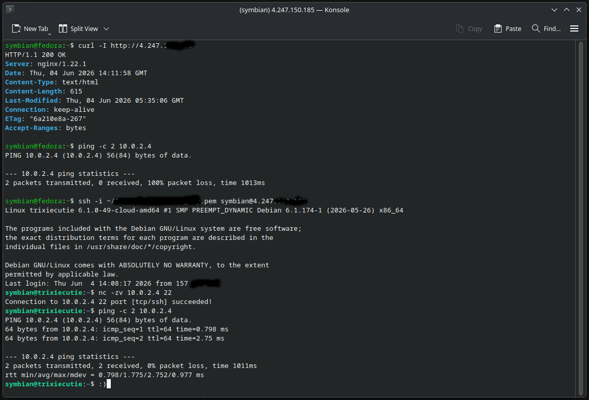

<div align='center'><h1>Secure Two-Tier Azure Infrastructure: Deploying a Defensible Bastion Architecture</h1></div>
<h2>Project Overview</h2>

This project demonstrates the design, deployment, and validation of a secure, decoupled two-tier network architecture in Microsoft Azure. By breaking away from default cloud routing behaviors, this environment enforces strict isolation boundaries to ensure a frontend public web server can securely communicate with a hidden backend database instance via an engineered, authorized path.

This deployment model follows the cloud security principles of Least Privilege and Defense-in-Depth, mimicking enterprise-grade architecture used to shield sensitive data tiers from raw public internet exposure.

🗺️ Network Architecture Design <a href='#terminal-image'>[ Skip to output :) ]</a>

The infrastructure is built inside a single Virtual Network (VNet) carved into two distinct subnet profiles:

Public Subnet (10.0.1.0/24): Hosts the frontend Web Server. This layer accepts HTTP public traffic and acts as a Bastion Host (Jump Box) for secure infrastructure management.

Private Subnet (10.0.2.0/24): Hosts the isolated Database Server. This layer has no public IP address and is entirely invisible to the public internet.



🛠️ Technical Components & Specs

Cloud Provider: Microsoft Azure

Region: Central India (centralindia)

Virtual Network Address Space: 10.0.0.0/16

Subnets:

Public Subnet: 10.0.1.0/24

Private Subnet: 10.0.2.0/24

Compute Instances: 2x Web-Server-01 (Ubuntu Server 24.04 LTS, Standard_B1s)

Frontend Provisioning: Automatic Nginx deployment via cloud-init User Data bootstrapping on initial boot.

Network Firewalls: Separate Network Security Groups (NSGs) with custom security rules.

🛡️ Firewall Configuration & Traffic Rules

To override Azure's standard, overly permissive lateral routing (AllowVnetInbound), custom stateful firewall rule matrices were implemented.

> Frontend Security Profile (NSG_Public)



> Backend Security Profile (NSG_Private)

The private database tier is heavily locked down using precise packet-matching attributes:



🧠 Critical Architecture Lesson: The Source/Destination Nuance

During configuration, we avoided setting the Source of Rule 110 to Any with Destination as VirtualNetwork.

If Source was Any (Flawed): It would intercept and drop Azure's internal platform health checks (specifically traffic from the AzureLoadBalancer service tag) because Rule 110 sits at a higher priority than the default rule 65001 (AllowAzureLoadBalancerInbound). This breaks platform diagnostics and monitoring.

With Source as VirtualNetwork, Destination as Any (Correct): It strictly intercepts and drops traffic originating internally within the VNet boundaries (preventing unauthorized lateral subnet communication), while allowing external platform-level AzureLoadBalancer health tags to bypass the rule entirely.

🚀 Deployment Steps & Hands-on Validation

Phase 1: Provisioning the Network Matrix

Created an isolated resource group named Netarch.

Allocated the overarching 10.0.0.0/16 CIDR block.

Carved out the individual /24 address paths for the Public and Private subnets.




Phase 2: Deploying Compute with Bootstrap Provisioning

Spun up Web-Server-01 in the public subnet. Passed a custom cloud-init bash script inside the User Data block to automate package repository updates and system-level Nginx execution on boot:
```
#!/bin/bash
sudo apt-get update -y
sudo apt-get install nginx -y
sudo systemctl start nginx
sudo systemctl enable nginx
```

Deployed the DB server in the private subnet without assigning an internet-facing Public IP.




Phase 3: Validating Stateful Ingress & Lateral Routing

Because traditional ICMP ping packets are blocked by our TCP-only stateful firewall rules, connectivity was verified using network-layer utility checks.

Public Web Verification: Verified Nginx was handling connections globally by querying the frontend's public IP layout from a local laptop:

curl -I http://4.247.x.x


Expected Response: HTTP/1.1 200 OK

Private Isolation Verification: Attempted to ping or connect to the private database IP directly from the local laptop.
Expected Outcome: The connection times out, confirming the database is completely isolated from direct internet access.

Bastion Host Jump Execution: Connected securely from the local laptop to the frontend public VM via SSH, then verified internal private subnet routing using Netcat:

# SSH into Bastion Host
ssh -i your-key.pem azureuser@<PUBLIC_IP_ADDRESS>

# Query the private DB instance over authorized internal network
nc -zv 10.0.2.4 22



<br>
It works :)
<br>
<h3>Learned the following : </h3>

* **Subnet Management:** Creating and configuring subnets.
* **Network Security:** Setting up Network Security Group (NSG) rules.
* **VM Deployment:** Spinning up Virtual Machines with private and public IPs and interconnections.
